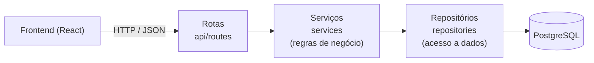

# Reserva Gávea — Sistema de Reserva de Quadras Esportivas

Aplicação web para **buscar, reservar e gerenciar quadras e campos esportivos**. O sistema atende dois perfis:

- **Atleta** — busca quadras por esporte e data, consulta a grade de horários, realiza e cancela reservas e gerencia seu perfil.
- **Administrador** — cadastra e mantém as quadras do complexo (horários de funcionamento, preços e comodidades), gerencia as reservas (registra pagamentos, cancela e reativa) e acompanha ocupação e faturamento no dashboard.

Um dos principais objetivos técnicos é **garantir que um mesmo horário nunca seja reservado por duas pessoas**, inclusive quando os pedidos chegam ao mesmo tempo.

Projeto acadêmico da disciplina de **Laboratório de Engenharia de Software**.

---

## Equipe

- Gustavo Felipe Morais
- Mariana Cavalcante Lins
- Uanderson Leonardo de Souza

---

## Funcionalidades Implementadas

| História | Funcionalidade |
| --- | --- |
| **US01** — Autenticação | Cadastro (com validação estrita de CPF ASCII) e login com JWT, perfis de atleta e administrador, renovação automática do token enquanto o usuário está ativo e sessão sincronizada entre abas (veja [Sessão e renovação do token](#sessão-e-renovação-do-token)) |
| **US02** — Perfil do Atleta | Visualização de dados cadastrais, edição de nome, telefone e cidade e alteração de senha com validação da senha atual |
| **US03** — Busca | Filtro de quadras por esporte e por data (mostra só quadras com horário livre no dia) |
| **US04** — Grade de horários | Grade por quadra e por dia, cruzando o horário de funcionamento com as reservas existentes |
| **US05** — Confirmação de reserva | Revisão e confirmação da reserva com bloqueio do horário, inclusive em pedidos simultâneos |
| **US06** — Minhas Reservas | Listagem de agendamentos futuros e histórico do atleta, com cancelamento respeitando antecedência mínima de 2 horas |
| **US07** — Gestão de Reservas (Admin) | Listagem de todas as reservas com filtros de período, quadra e status (com nome do atleta e da quadra), registro de pagamento, cancelamento sem a antecedência mínima do atleta e reativação de reservas canceladas, protegida contra horário duplicado |
| **US08** — Infraestrutura (Admin) | CRUD completo de quadras: cadastrar, listar, editar, inativar e reativar |
| **US09** — Dashboard e Relatórios (Admin) | Indicadores por período: reservas por status, faturamento realizado, a receber e previsto, ocupação por quadra e geral e reservas por esporte, com cards e barras (veja [Métricas do dashboard](#métricas-do-dashboard)) |

---

## Stack

| Camada | Tecnologias |
| --- | --- |
| Backend | Python 3.12+, **FastAPI**, SQLAlchemy 2, Alembic (migrações), Pydantic, JWT (python-jose), argon2 (pwdlib) |
| Banco de dados | **PostgreSQL** |
| Frontend | **React** 19 + TypeScript, Vite |
| Infraestrutura | **Docker** e **Docker Compose** |

---

## Arquitetura

O backend é organizado em camadas, cada uma com uma responsabilidade:



| Pasta | Responsabilidade |
| --- | --- |
| `api/routes` | Recebe as requisições HTTP, valida a entrada com os schemas e chama o serviço. Não contém regra de negócio. |
| `services` | Regras de negócio (ex.: horário já iniciado, antecedência de cancelamento, preço alterado, limite de 30 dias). |
| `repositories` | **Único lugar com acesso ao banco** (consultas, inserções e atualizações). |
| `models` | Entidades do banco (SQLAlchemy). |
| `schemas` | Formatos de entrada e saída da API (Pydantic). |
| `core` | Configuração, segurança (JWT e senhas), exceções de domínio e horário oficial. |

### Repository Pattern

Toda operação no banco fica em classes de repositório (`UsuarioRepository`, `QuadraRepository`, `ReservaRepository`). Os serviços recebem o repositório pronto e não conhecem SQL nem a sessão do banco. Isso isola as regras de negócio do acesso a dados e permite trocar ou simular o banco sem mexer nas regras.

Restrição do projeto: **não há decorators customizados nas regras de negócio**. Os únicos decorators usados são os da própria infraestrutura (rotas do FastAPI, validadores do Pydantic e `@dataclass`).

### Garantia contra reserva duplicada

A regra "um horário, uma reserva" é garantida **pelo próprio banco**, com um índice único parcial em quadra + data + horário (desconsiderando reservas canceladas). Se dois atletas confirmarem o mesmo horário ao mesmo tempo, só um consegue; o outro recebe a resposta `409 — Esse horário já foi reservado`. Em teste com **10 pedidos simultâneos para o mesmo horário, apenas 1 reserva foi criada**.

O índice vale para **qualquer gravação que deixe uma reserva ativa**, não só para a criação: quando o administrador reativa uma reserva cancelada cujo horário já foi ocupado, a resposta também é `409`. Toda gravação de reserva passa pelo mesmo ponto do `ReservaRepository` (`_confirmar()`), que desfaz a transação em qualquer falha e só transforma em `409` a violação desse índice, identificada pelo nome da constraint informado pelo PostgreSQL; outros erros do banco não são mascarados. O `QuadraRepository` segue o mesmo cuidado com o índice de nome único das quadras.

### Status da reserva

| Status | Como a reserva chega nele |
| --- | --- |
| `pendente` | ao ser criada pelo atleta (US05) ou ao ser reativada pelo administrador (US07) |
| `paga` | **somente pela ação do administrador** na tela Gestão de Reservas (US07). O sistema não tem pagamento online: o administrador registra o pagamento recebido no complexo. |
| `cancelada` | pelo atleta, com pelo menos 2 horas de antecedência (US06), ou pelo administrador, a qualquer momento (US07) |

Mudanças que o administrador pode fazer: `pendente → paga`, `paga → pendente` (desfazer um pagamento marcado por engano), `pendente/paga → cancelada` e `cancelada → pendente` (reativar, só se o horário ainda não começou e a quadra estiver ativa). Uma reserva cancelada não vai direto para `paga`: ela é reativada como pendente e depois marcada como paga.

### Métricas do dashboard

`GET /admin/metricas?inicio=&fim=` (tela **Dashboard**, só administrador). Definições usadas:

| Métrica | Definição |
| --- | --- |
| Período | Pela **data do jogo** (`reserva.data`), não pela data em que a reserva foi feita. Sem datas, vale o **mês atual**; `inicio` e `fim` vêm juntos, com no máximo **366 dias**. |
| Valores | `reserva.valor`, o **preço do momento da reserva**: mudar o preço da quadra depois não altera relatórios passados. |
| Reservas por status | Quantidade de pendentes, pagas e canceladas no período, e o total. |
| Faturamento realizado | Soma das reservas **pagas**. Como uma reserva só fica paga pela ação do administrador (veja [Status da reserva](#status-da-reserva)), é o que foi efetivamente registrado como recebido. |
| Faturamento a receber | Soma das reservas **pendentes**. |
| Faturamento previsto | **Pagas + pendentes**. Reservas **canceladas nunca contam**. |
| Ocupação por quadra | Horas reservadas (pendentes + pagas; cada reserva dura 1 hora) ÷ ((fechamento − abertura) × dias do período). Entram as quadras ativas e as **inativas que tenham reservas ativas no período** (marcadas como inativas). |
| Ocupação geral | Soma das horas reservadas ÷ soma das horas de funcionamento das quadras listadas. Sem quadras, a taxa é 0. |
| Por esporte | Reservas ativas (pendentes + pagas) e faturamento previsto, agrupados pelo esporte da quadra. |

**Limitações conhecidas:** a ocupação usa o **horário de funcionamento atual** de cada quadra (o sistema não guarda histórico de mudanças de horário nem de quando a quadra ficou inativa), e o agrupamento por esporte usa o esporte atual da quadra.

### Sessão e renovação do token

**Backend — `POST /auth/refresh`.** Recebe no cabeçalho `Authorization` um token **ainda válido** (assinatura correta e não expirado), confere se o usuário **continua existindo e ativo** e devolve um token novo com validade cheia (`ACCESS_TOKEN_EXPIRE_MINUTES`, 60 minutos por padrão) e os dados atuais do usuário, inclusive o perfil lido do banco. Sem token, a resposta é `401 — Autenticação necessária.`; token inválido ou expirado, ou usuário inativo, recebe `401 — Sessão inválida ou expirada.` Cada token carrega um `sid` (identificador da sessão, criado a cada login e mantido nas renovações) e um `jti` (identificador único do token).

**Frontend — quando renova** (`useSessao` + `services/renovacaoSessao.ts`). A sessão é verificada a cada 15 segundos, quando a aba volta a ficar visível e a cada interação do usuário (clique, toque, tecla ou rolagem). O token só é renovado quando as três condições valem juntas:

- faltam **5 minutos ou menos** para ele expirar;
- houve **atividade do usuário nos últimos 5 minutos**;
- a **aba está visível**.

Sem atividade, o token não é renovado e a sessão expira normalmente; um token já expirado encerra a sessão e leva para o login.

**Trava entre abas (Web Locks).** A renovação roda dentro de `navigator.locks.request("reserva-gavea:renovacao-jwt", { ifAvailable: true })`: se outra aba já está renovando, esta não tenta de novo, e quem obtém a trava confere outra vez se o token ainda é o mesmo antes de chamar a API. Se o navegador não oferece Web Locks (por exemplo, fora de HTTPS ou `localhost`), o frontend não renova, para não arriscar duas renovações ao mesmo tempo, e a sessão expira no horário normal.

**Sincronização entre abas.** O token fica no `localStorage`; as outras abas percebem a troca pelo evento `storage`. Uma renovação da mesma sessão (mesmo `sid` e mesmo usuário) mantém a tela, os modais e os formulários abertos; um novo login (outro `sid` ou outra conta) recarrega os dados do usuário; sair em uma aba leva todas para o login.

**Proteção contra 401 atrasado.** Cada requisição autenticada guarda o token com que foi enviada. Se ela responder `401`, a sessão só é encerrada quando aquele **ainda é o token atual**; a resposta atrasada de um pedido feito com um token antigo (já renovado ou de um login anterior) é ignorada e não derruba a sessão nova. Pelo mesmo motivo, a tela Meu Perfil descarta a resposta de um salvamento se a sessão mudou enquanto o pedido estava em andamento.

### Frontend

Componentes funcionais com Hooks. As chamadas à API ficam em `src/services`, separadas das telas (`src/pages`) e dos componentes (`src/components`); a lógica de estado reutilizável fica em `src/hooks`. Erros de validação HTTP `422` da API são mapeados e exibidos diretamente abaixo de cada campo do formulário.

---

## Rotas da API

Documentação interativa completa em `http://127.0.0.1:8000/docs` com a API rodando.

| Método | Rota | Acesso | Descrição |
| --- | --- | --- | --- |
| POST | `/auth/register` | público | cadastro de atleta |
| POST | `/auth/login` | público | login (retorna o token JWT) |
| POST | `/auth/refresh` | logado (token ainda válido) | gera um token novo para a mesma sessão, se o usuário continua ativo (veja [Sessão e renovação do token](#sessão-e-renovação-do-token)) |
| GET | `/auth/me` | logado | dados do usuário logado |
| PATCH | `/auth/me` | logado | atualiza nome, telefone e cidade do usuário logado |
| PATCH | `/auth/me/senha` | logado | altera a senha do usuário logado |
| GET | `/quadras?esporte=&data=` | público | quadras ativas, com filtros opcionais |
| GET | `/quadras/{id}` | público | detalhe de uma quadra ativa |
| GET | `/quadras/{id}/horarios?data=` | público | grade de horários do dia |
| GET | `/reservas/minhas` | logado | lista reservas futuras e histórico do atleta logado |
| POST | `/reservas` | logado | cria uma reserva |
| PATCH | `/reservas/{id}/cancelar` | logado | cancela uma reserva (antecedência mínima de 2h) |
| GET / POST | `/admin/quadras` | administrador | lista todas / cadastra |
| PUT / DELETE | `/admin/quadras/{id}` | administrador | edita / inativa |
| GET | `/admin/reservas?inicio=&fim=&quadra_id=&status=` | administrador | todas as reservas, com filtros opcionais, nome do atleta e da quadra |
| PATCH | `/admin/reservas/{id}/status` | administrador | marca como paga, desfaz o pagamento, cancela ou reativa (veja [Status da reserva](#status-da-reserva)) |
| GET | `/admin/metricas?inicio=&fim=` | administrador | indicadores do período para o dashboard (veja [Métricas do dashboard](#métricas-do-dashboard)) |
| GET | `/health` | público | verifica se a API está no ar |

---

## Como rodar

O passo a passo completo (Docker Compose, execução local e criação do administrador) está em
**[Atv_grupo_1/documents/InstallationGuide.md](Atv_grupo_1/documents/InstallationGuide.md)**.

### Opção rápida com Docker Compose

```bash
cd Atv_grupo_1
docker compose up --build -d
# Frontend: http://localhost:5173 | API Swagger: http://localhost:8000/docs
```

---

## Testes

O backend tem **139 testes automatizados** (pytest) cobrindo autenticação, renovação do token, edição de perfil, CRUD de quadras, busca, grade de horários, regras de reserva, cancelamento, gestão de reservas pelo administrador, métricas do dashboard, tratamento de erros de integridade nos repositórios e concorrência, executados contra um banco PostgreSQL de testes separado.

```bash
cd Atv_grupo_1/backend
pip install -r requirements-dev.txt
pytest
```

O frontend tem **5 testes da sessão** (renovação do token, trava entre abas e proteção contra 401 atrasado), escritos com o executor de testes do próprio Node.js, sem dependências novas:

```bash
cd Atv_grupo_1/frontend
npm run test:sessao
```

Resultados, casos de teste e o detalhamento dos testes de concorrência (50 pedidos simultâneos em 5 rodadas: 5 aprovados, 45 barrados, nenhuma reserva duplicada; e a reativação pelo administrador disputando o horário com 9 atletas, também com 1 só vencedor por rodada) estão em
**[Atv_grupo_1/documents/TestExecutionReport.md](Atv_grupo_1/documents/TestExecutionReport.md)**.

---

## Estrutura do repositório

```text
Atv_grupo_1/
├── docker-compose.yml      # orquestração de PostgreSQL, backend e frontend
├── backend/
│   ├── alembic/versions/   # migrações do banco
│   ├── app/
│   │   ├── api/routes/     # rotas HTTP
│   │   ├── core/           # configuração, segurança, exceções, horário
│   │   ├── db/             # conexão com o banco
│   │   ├── models/         # entidades
│   │   ├── repositories/   # acesso a dados (Repository Pattern)
│   │   ├── schemas/        # entrada/saída da API
│   │   ├── scripts/        # utilitários (promover administrador)
│   │   └── services/       # regras de negócio
│   └── tests/              # testes automatizados (pytest)
├── frontend/
│   ├── src/
│   │   ├── components/     # componentes reutilizáveis (layout, modais, cards)
│   │   ├── hooks/          # lógica de estado (sessão, quadras, grade, relógio, reservas do admin, métricas)
│   │   ├── pages/          # telas (login, cadastro, início, horários, minhas reservas, perfil, quadras, gestão de reservas, dashboard)
│   │   ├── services/       # chamadas à API, sessão e renovação do token
│   │   ├── styles/         # CSS
│   │   └── utils/          # formatação de datas, preços e esportes
│   └── tests/              # testes da sessão (npm run test:sessao)
└── documents/              # DER, guia de instalação e relatório de testes
```

---

## Status do projeto

Todas as histórias de usuário (**US01 a US09**) e as dívidas técnicas das Sprints 1 e 2 (**renovação automática do token JWT** e **proteção e sincronização do estado da sessão entre abas**) foram entregues.

---

## Fluxo de trabalho

- `main` — versões entregues ao fim de cada sprint.
- `Develop` — integração do trabalho em andamento.
- Uma branch por funcionalidade (`feat/...`, `fix/...`, `chore/...`, `docs/...`), integrada à `Develop` por Pull Request.